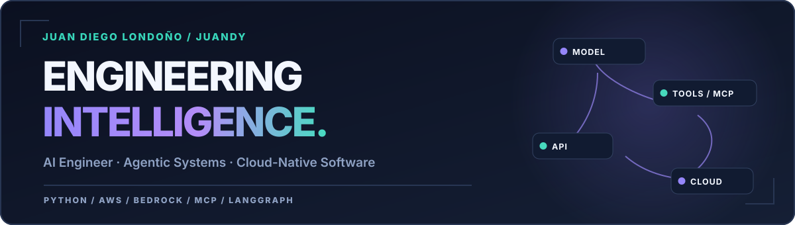

<!-- JuanDLCH · Clean Pro v2 · GitHub Profile README -->

  <picture>
    <source media="(prefers-color-scheme: dark)" srcset="./assets/hero-dark.svg">
    <source media="(prefers-color-scheme: light)" srcset="./assets/hero-light.svg">
    
  </picture>

  
  
  

### Hey, I'm Juandy. 👋

I'm **Juan Diego Londoño**, an **AI Engineer & Software Engineer** based in Medellín, Colombia.

I design and ship **AI-native applications** — agents that call tools, work across business systems, manage state, and perform meaningful tasks. My background spans **backend and full-stack software**, while my current work centers on **generative AI, agent orchestration, and AWS cloud architecture**.

> **What I care about:** taking AI from a promising demo to a secure, observable, maintainable system.

### What I engineer

<table>
  <tr>
    <td width="50%" valign="top"><strong>🧠 Agentic systems</strong>  Tool calling, LangGraph orchestration, MCP servers and clients, structured outputs, memory, approval gates, and multi-step execution.</td>
    <td width="50%" valign="top"><strong>🎙️ Voice & document AI</strong>  Voice experiences (STT/TTS), multimodal/document workflows, OCR, retrieval, RAG, and business-facing conversational applications.</td>
  </tr>
  <tr>
    <td width="50%" valign="top"><strong>☁️ Backend & cloud platforms</strong>  Python/TypeScript APIs, event-driven systems, serverless computing, containers, data services, and AWS deployments.</td>
    <td width="50%" valign="top"><strong>🔗 Full-stack & integrations</strong>  Web interfaces, messaging channels, Meta WhatsApp Business Platform, third-party APIs, automation, and user-facing workflows.</td>
  </tr>
</table>

### Technology ecosystem

Deepest focus: AI engineering, backend and AWS. Frontend is part of my full-stack background — I don't pretend every tool below is my daily driver.

#### AI, agents & LLMs

  
  
  
  
  
  
  
  

Amazon Bedrock · Bedrock AgentCore · Amazon Nova · SageMaker · LangGraph · LangChain · MCP · Claude

Also: OpenAI API · LlamaIndex · agent/tool orchestration · RAG · embeddings · semantic search & reranking · model routing · evaluations & tracing

#### Voice, vision & document intelligence

  
  
  
  
  

Deepgram · ElevenLabs · Amazon Transcribe · Textract · Rekognition · OCR · STT/TTS pipelines · multimodal workflows

#### Languages, backend & APIs

FastAPI · Pydantic · Zod · REST APIs · WebSockets · SSE/streaming · webhooks · authentication & authorization · Pytest

#### Frontend & UI

  
  
  
  

React · Next.js · Tailwind CSS · Material UI · Ant Design · Angular · component libraries · dashboards · responsive interfaces. Earlier experience also includes Vue.

#### Engineering tools & delivery

AWS SAM · Infrastructure as Code · GitHub Actions · CI/CD · containers · Linux · observability · cloud operations

#### Data & storage

  
  
  

PostgreSQL / Aurora Serverless · DynamoDB · Redis / Valkey · MongoDB · S3 · Redshift · Glue · DMS · SQL

#### Integrations & automation

  
  
  
  
  
  

Meta WhatsApp Business Platform / Cloud API · Twilio · Discord bots · HubSpot CRM · Google Drive APIs · n8n · webhook automation · Selenium / UiPath / PyAutoGUI

  
<strong>Earlier & complementary experience</strong>

   
  <strong>Other languages & web:</strong> Java, C#, Angular, Vue, Bootstrap, HTML/CSS, JavaScript frontend tooling. 
  <strong>Data science & automation:</strong> Pandas, NumPy, Matplotlib, Jupyter, Python scripting, UiPath, Selenium, PyAutoGUI. 
  <strong>Additional tooling:</strong> Voiceflow, low-code workflows, notebooks and rapid prototyping.
    

### AWS Cloud Stack

Services I've worked with across AI engineering, serverless applications, data platforms and cloud operations. All icons are stored in this repository.

<table>
  <tr>
    <td width="50%" valign="top">
      <strong>AI & Machine Learning</strong>  
      
      
      
      
      
      
      
       Amazon Bedrock · Bedrock AgentCore · Amazon Nova · SageMaker AI · Textract · Rekognition · Transcribe
    </td>
    <td width="50%" valign="top">
      <strong>Compute & Containers</strong>  
      
      
      
      
      
       AWS Lambda · Amazon EC2 · Amazon ECS · AWS Fargate · Amazon ECR
    </td>
  </tr>
  <tr>
    <td width="50%" valign="top">
      <strong>Networking & Web Delivery</strong>  
      
      
      
      
       API Gateway · CloudFront · AWS WAF · AWS Amplify
    </td>
    <td width="50%" valign="top">
      <strong>Databases & Storage</strong>  
      
      
      
      
      
       Amazon S3 · DynamoDB · Amazon RDS · Aurora Serverless · ElastiCache / Valkey
    </td>
  </tr>
  <tr>
    <td width="50%" valign="top">
      <strong>Data, Analytics & Migration</strong>  
      
      
      
       AWS Glue · Amazon Redshift · AWS DMS
    </td>
    <td width="50%" valign="top">
      <strong>Events, Workflows & Messaging</strong>  
      
      
      
      
      
       EventBridge / Scheduler · Amazon SQS · Step Functions · Amazon SES · Amazon Pinpoint
    </td>
  </tr>
  <tr>
    <td width="50%" valign="top">
      <strong>Security & Identity</strong>  
      
      
      
      
       Amazon Cognito · AWS IAM · Secrets Manager · Systems Manager / Parameter Store
    </td>
    <td width="50%" valign="top">
      <strong>Observability & Infrastructure</strong>  
      
      
       Amazon CloudWatch · AWS CloudFormation
    </td>
  </tr>
</table>

Additional experience: AWS SAM, EventBridge Scheduler, Aurora PostgreSQL / Serverless, and Valkey Serverless. AWS Architecture Icons are provided by AWS.

### Selected engineering work

| Focus | What I've built |
| :--- | :--- |
| **Enterprise agent systems** | Tool-connected assistants with orchestration, persistent context, streamed execution, permission boundaries, and human-in-the-loop approvals. |
| **Conversational, voice & document AI** | Applications that combine LLMs, retrieval, OCR, STT/TTS, and external services into real business workflows. |
| **AWS-native platforms** | Backend APIs and production workloads with serverless components, authentication, data persistence, logging, tracing, testing, and CI/CD. |
| **Full-stack products & integrations** | Web interfaces, ERP-style applications, API integrations, messaging automation, and operational tooling. |

Most of my recent professional engineering lives in private organizations. These descriptions intentionally avoid confidential source code and implementation details.

### GitHub snapshot

  <picture>
    <source media="(prefers-color-scheme: dark)" srcset="https://github-stats-extended.vercel.app/api?username=JuanDLCH&show_icons=true&include_all_commits=true&hide_border=true&theme=github_dark">
    <source media="(prefers-color-scheme: light)" srcset="https://github-stats-extended.vercel.app/api?username=JuanDLCH&show_icons=true&include_all_commits=true&hide_border=true&theme=default">
    
  </picture>

Public metrics are only part of the picture: much of my recent work lives in private repositories.

---

  <strong>Useful AI over impressive demos.</strong> 
  Outside the terminal: Linux tinkering, automation experiments, and football — usually as a goalkeeper. ⚽  
  <a href="https://www.linkedin.com/in/juandlch/">Let's connect</a>
  &nbsp; · &nbsp;
  <a href="mailto:juandiego0329@gmail.com">Get in touch</a>

