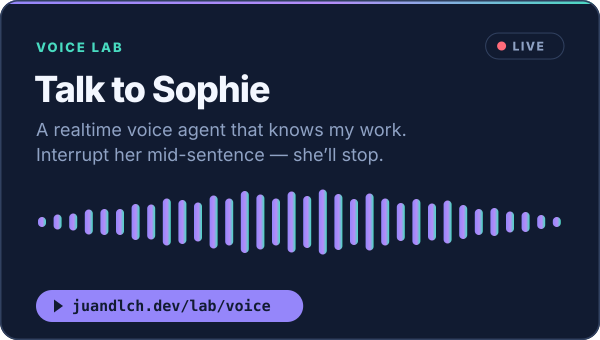
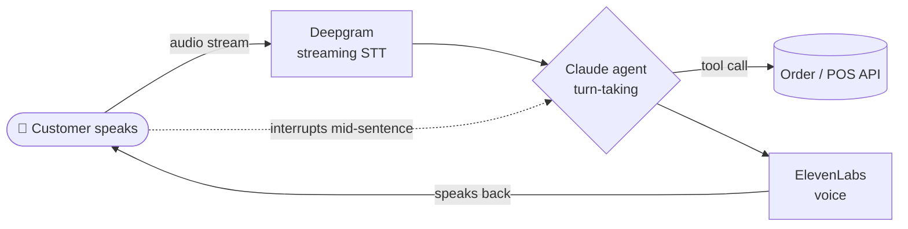
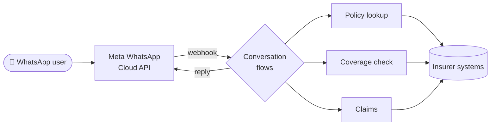
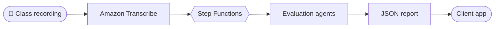
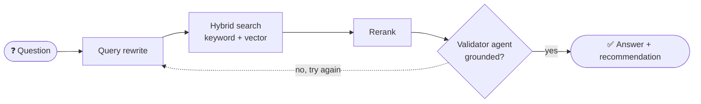

<!--
  👋 Reading the source? Same energy.
  Every animation on this page is a hand-built SVG (CSS keyframes, no GIFs, no JS),
  generated from scripts/build-svgs.mjs in dark and light. Say hi: juandiego0329@gmail.com
-->

  <picture>
    <source media="(prefers-color-scheme: dark)" srcset="./assets/hero-dark.svg">
    <source media="(prefers-color-scheme: light)" srcset="./assets/hero-light.svg">
    
  </picture>

  
  
  
  
  
  
  

### Hey, I'm Juandy 👋

I'm **Juan Diego Londoño**, a **Lead AI Engineer** from **Medellín, Colombia**. I design and ship AI that does real work: **agents** that call tools and keep state, **realtime voice** you can interrupt, and **document AI** that reads what businesses actually send. I take each project from the client's first question to running on AWS.

I'm a software engineer first: full stack in 2022, then backend and cloud, and now I lead AI projects end to end. That covers discovery, architecture, cost and time estimates, the team and delivery.

  
<strong>🇨🇴 Léelo en español</strong>

   

Soy **Juan Diego Londoño (Juandy)**, **Lead AI Engineer** en **Medellín, Colombia**. Diseño y llevo a producción IA que hace trabajo real: **agentes** que usan herramientas y mantienen estado, **voz en tiempo real** que puedes interrumpir y **IA documental** que lee lo que las empresas realmente envían. Acompaño cada proyecto desde la primera pregunta del cliente hasta que corre en AWS.

Primero soy ingeniero de software: full stack en 2022, luego backend y nube, y hoy lidero proyectos de IA de punta a punta: descubrimiento, arquitectura, estimación de costos y tiempos, coordinación del equipo y entrega.

- 🎙️ **Habla con mi CV:** [Sophie](https://juandlch.dev/lab/voice) es un agente de voz que conoce mi trabajo. Interrúmpela cuando quieras.
- 💬 **Mira al agente pensar:** el [Chat Lab](https://juandlch.dev/lab/chat) muestra cada paso del agente en vivo.
- 📄 **CV:** [Español](https://juandlch.dev/cv/Juan-Londono_AI-Engineer_ES.pdf) · [English](https://juandlch.dev/cv/Juan-Londono_AI-Engineer.pdf)
- 📅 **¿Hablamos?** [Agenda una llamada](https://calendar.app.google/6ae9dpvPz8mEiRRdA) o escríbeme a [juandiego0329@gmail.com](mailto:juandiego0329@gmail.com).

Fuera del teclado: arquero de fútbol, Linux y experimentos de automatización. ⚽🐧

<picture>
  <source media="(prefers-color-scheme: dark)" srcset="./assets/terminal-dark.svg">
  <source media="(prefers-color-scheme: light)" srcset="./assets/terminal-light.svg">
  
</picture>

### Don't take my word for it. Try it 👇

  <a href="https://juandlch.dev/lab/voice"><picture>
    <source media="(prefers-color-scheme: dark)" srcset="./assets/lab-voice-dark.svg">
    <source media="(prefers-color-scheme: light)" srcset="./assets/lab-voice-light.svg">
    
  </picture></a>
  <a href="https://juandlch.dev/lab/chat"><picture>
    <source media="(prefers-color-scheme: dark)" srcset="./assets/lab-chat-dark.svg">
    <source media="(prefers-color-scheme: light)" srcset="./assets/lab-chat-light.svg">
    
  </picture></a>

Both are live demos on <a href="https://juandlch.dev">juandlch.dev</a>. Click a card, say hi, and try to break them.

### What I've shipped

Client names are anonymised and the work lives in private repos, so these are the shapes of the systems. Click a case file to open it.

  
<strong>🍔 Drive-thru voice AI</strong>: a voice agent that takes your order, and lets you interrupt it

   

Realtime voice agents for a quick-service chain that take orders at the drive-thru. I built the voice integration with **ElevenLabs on Claude models**, including turn-taking, interruptions (barge-in) and placing the order into the system.

  Claude · ElevenLabs · Deepgram · WebSockets · AWS

  
<strong>🛡️ Insurance assistant on WhatsApp</strong>: policies, coverage and claims inside a chat

   

Built and evolved conversations on **Meta's WhatsApp Cloud API** for an insurer: policy lookups, coverage checks, claims, and connections to the insurer's own systems. I also migrated the older flows.

  WhatsApp Cloud API · Meta · insurer integrations

  
<strong>🎓 Automated class evaluation</strong>: from a recorded class to a structured report

   

I helped build a pipeline that **transcribes class recordings**, orchestrates the work with **Step Functions**, and runs **evaluation agents** that return JSON reports for the client's app.

  Amazon Transcribe · Step Functions · evaluation agents

  
<strong>🎬 Cinema conversational assistant</strong>: RAG that knows what's playing tonight

   

A digital-channel assistant that answers from the live listings and recommends what to watch. I worked on retrieval, recommendation logic, backend integrations and the AWS architecture. The retrieval loop below is the pattern I keep coming back to.

RAG · hybrid search · reranking · AWS

Also shipped: OCR and agents for financial services, HubSpot CRM integrations, and AWS data pipelines.

### The road so far

<picture>
  <source media="(prefers-color-scheme: dark)" srcset="./assets/timeline-dark.svg">
  <source media="(prefers-color-scheme: light)" srcset="./assets/timeline-light.svg">
  
</picture>

  
  
  
  

### Daily drivers

  
  
  
  
  
  
  
  

Hover an icon for its name. My deepest focus is AI engineering, backend and AWS. Frontend is part of my full-stack background, and I won't pretend every tool below is a daily driver.

  
<strong>🧰 Open the full toolbox</strong>: AI, voice, backend, frontend, data, integrations

   

#### AI, agents & LLMs

  
  
  
  
  
  
  
  

Amazon Bedrock · Bedrock AgentCore · Amazon Nova · SageMaker · LangGraph · LangChain · MCP · Claude

Also: OpenAI API · LlamaIndex · agent/tool orchestration · RAG · embeddings · semantic search & reranking · model routing · evaluations & tracing

#### Voice, vision & document intelligence

  
  
  
  
  

Deepgram · ElevenLabs · Amazon Transcribe · Textract · Rekognition · OCR · STT/TTS pipelines · multimodal workflows

#### Languages, backend & APIs

FastAPI · Pydantic · Zod · REST APIs · WebSockets · SSE/streaming · webhooks · authentication & authorization · Pytest

#### Frontend & UI

  
  
  
  

React · Next.js · Tailwind CSS · Material UI · Ant Design · Angular · component libraries · dashboards · responsive interfaces. Earlier experience also includes Vue.

#### Engineering tools & delivery

AWS SAM · Infrastructure as Code · GitHub Actions · CI/CD · containers · Linux · observability · cloud operations

#### Data & storage

  
  
  

PostgreSQL / Aurora Serverless · DynamoDB · Redis / Valkey · MongoDB · S3 · Redshift · Glue · DMS · SQL

#### Integrations & automation

  
  
  
  
  
  

Meta WhatsApp Business Platform / Cloud API · Twilio · Discord bots · HubSpot CRM · Google Drive APIs · n8n · webhook automation · Selenium / UiPath / PyAutoGUI

  
<strong>Earlier & complementary experience</strong>

   
  <strong>Other languages & web:</strong> Java, C#, Angular, Vue, Bootstrap, HTML/CSS, JavaScript frontend tooling. 
  <strong>Data science & automation:</strong> Pandas, NumPy, Matplotlib, Jupyter, Python scripting, UiPath, Selenium, PyAutoGUI. 
  <strong>Additional tooling:</strong> Voiceflow, low-code workflows, notebooks and rapid prototyping.
    

  
<strong>☁️ AWS Cloud Stack</strong>: 35 services across AI, compute, data, events and security

   

Services I've worked with across AI engineering, serverless applications, data platforms and cloud operations. All icons are stored in this repository.

<table>
  <tr>
    <td width="50%" valign="top">
      <strong>AI & Machine Learning</strong>  
      
      
      
      
      
      
      
       Amazon Bedrock · Bedrock AgentCore · Amazon Nova · SageMaker AI · Textract · Rekognition · Transcribe
    </td>
    <td width="50%" valign="top">
      <strong>Compute & Containers</strong>  
      
      
      
      
      
       AWS Lambda · Amazon EC2 · Amazon ECS · AWS Fargate · Amazon ECR
    </td>
  </tr>
  <tr>
    <td width="50%" valign="top">
      <strong>Networking & Web Delivery</strong>  
      
      
      
      
       API Gateway · CloudFront · AWS WAF · AWS Amplify
    </td>
    <td width="50%" valign="top">
      <strong>Databases & Storage</strong>  
      
      
      
      
      
       Amazon S3 · DynamoDB · Amazon RDS · Aurora Serverless · ElastiCache / Valkey
    </td>
  </tr>
  <tr>
    <td width="50%" valign="top">
      <strong>Data, Analytics & Migration</strong>  
      
      
      
       AWS Glue · Amazon Redshift · AWS DMS
    </td>
    <td width="50%" valign="top">
      <strong>Events, Workflows & Messaging</strong>  
      
      
      
      
      
       EventBridge / Scheduler · Amazon SQS · Step Functions · Amazon SES · Amazon Pinpoint
    </td>
  </tr>
  <tr>
    <td width="50%" valign="top">
      <strong>Security & Identity</strong>  
      
      
      
      
       Amazon Cognito · AWS IAM · Secrets Manager · Systems Manager / Parameter Store
    </td>
    <td width="50%" valign="top">
      <strong>Observability & Infrastructure</strong>  
      
      
       Amazon CloudWatch · AWS CloudFormation
    </td>
  </tr>
</table>

Additional experience: AWS SAM, EventBridge Scheduler, Aurora PostgreSQL / Serverless, and Valkey Serverless. AWS Architecture Icons are provided by AWS.

### GitHub snapshot

  <picture>
    <source media="(prefers-color-scheme: dark)" srcset="https://github-stats-extended.vercel.app/api?username=JuanDLCH&show_icons=true&include_all_commits=true&hide_border=true&theme=github_dark">
    <source media="(prefers-color-scheme: light)" srcset="https://github-stats-extended.vercel.app/api?username=JuanDLCH&show_icons=true&include_all_commits=true&hide_border=true&theme=default">
    
  </picture>

Public numbers only tell part of the story. Most of my recent work lives in private repos.

 

<a href="https://www.linkedin.com/in/juandlch/">
  <picture>
    <source media="(prefers-color-scheme: dark)" srcset="./assets/footer-dark.svg">
    <source media="(prefers-color-scheme: light)" srcset="./assets/footer-light.svg">
    
  </picture>
</a>

  <a href="https://www.linkedin.com/in/juandlch/">Let's connect</a>
  &nbsp;·&nbsp;
  <a href="mailto:juandiego0329@gmail.com">Get in touch</a>
  &nbsp;·&nbsp;
  <a href="https://calendar.app.google/6ae9dpvPz8mEiRRdA">Book a call</a>
  &nbsp;·&nbsp;
  <a href="https://juandlch.dev">juandlch.dev</a>

